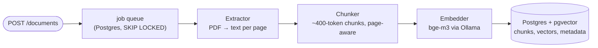
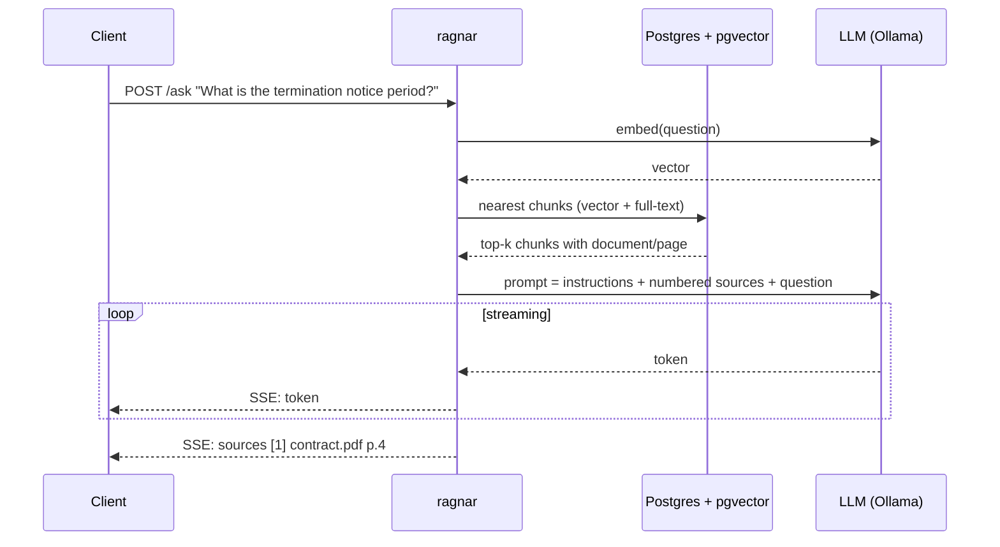

# ragnar

A document question-answering service in Go: upload PDFs, ask questions about them, and get answers that cite the exact document and page they came from. Built from scratch — no LLM frameworks — to understand what actually goes into a production retrieval-augmented generation (RAG) system: ingestion pipelines, embeddings and vector search, hybrid retrieval and reranking, tool-calling agents, an MCP server, evaluation, observability, and guardrails against prompt injection.

Runs fully local on [Ollama](https://ollama.com) by default, with optional hosted providers behind the same interface.

## Architecture

Two flows share one Postgres database. Ingestion turns PDFs into searchable chunks in the background:



Querying retrieves the most relevant chunks and has the model answer from them, streaming tokens back with citations:



## Stack

- **Go** with [chi](https://github.com/go-chi/chi) for HTTP, no LLM frameworks
- **Ollama** for local inference — `qwen3:8b` (chat/agent), `bge-m3` (embeddings)
- **Postgres 18 + pgvector** for vectors, full-text search, metadata, and the job queue
- **pdftotext** (poppler) for PDF extraction
- **OpenTelemetry + Jaeger** for tracing
- **MCP** (official Go SDK) to expose the document tools to any MCP client

## Getting started

Prerequisites: Go 1.25+, Docker, `pdftotext` (`poppler-utils`), and [Ollama](https://ollama.com/download) running on the host.

```bash
ollama pull qwen3:8b
ollama pull bge-m3

cp .env.example .env
docker compose up -d
```
